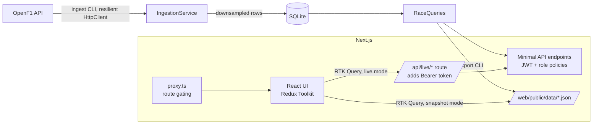

# Pit Wall

Replay a Grand Prix the way a race strategist sees it: every car moving on the track map, a timing tower that stays in sync, tyre strategy, gaps to the leader and fastest-lap telemetry.

**Live demo:** https://kenn-pit-wall.vercel.app (sign in with one of the demo accounts on the login page)

Races included: 2025 Abu Dhabi GP (title decider), 2025 British GP (safety cars, intermediates), 2025 Italian GP.

## Stack

| Layer | Tech |
| --- | --- |
| API | .NET 10 minimal APIs, EF Core + SQLite, `HttpClient` + `Microsoft.Extensions.Http.Resilience`, JWT bearer auth with role policies, OpenAPI (Scalar UI at `/docs`), health checks, ProblemDetails |
| Web | Next.js 16 (App Router), TypeScript (strict), Tailwind CSS 4, Redux Toolkit + RTK Query, d3-scale/d3-shape for charts, `jose` for session tokens |
| Tests | xUnit (domain maths + API authorization), Vitest + React Testing Library (selectors, reducers, race maths, auth helpers, components), Cypress + axe (user flows, role gating, accessibility) |

## Architecture



The API is the single source of truth for data shapes. `dotnet run -- export` writes the **exact** API responses to `web/public/data`, so the web app runs in two modes with the same code:

- **Snapshot mode** (default, what Vercel runs): RTK Query reads `/data/*.json`. No backend needed.
- **Live mode** (`NEXT_PUBLIC_DATA_MODE=live`, `API_URL=...`): RTK Query calls `/api/live/*`, a small Next.js route that forwards to the .NET API with the user's token.

See [application-flow.md](application-flow.md) for the user flows, data flow and auth sequence.

## Run locally

Prerequisites: .NET 10 SDK, Node 22.

```bash
# 1. Web app in snapshot mode (no backend needed)
cd web
npm install
echo "AUTH_SECRET=$(openssl rand -base64 48)" > .env.local
npm run dev            # http://localhost:3000

# 2. API (optional): ingest races, export the snapshot, serve live
cd api
dotnet run -- ingest 9839 9947 9912      # minutes on first run; raw responses are cached in api/db/openf1-cache
dotnet run -- export ../web/public/data  # refresh the snapshot
Auth__Secret="<same value as AUTH_SECRET>" dotnet run --urls http://localhost:5101

# 3. Web app against the live API
cd web
NEXT_PUBLIC_DATA_MODE=live API_URL=http://localhost:5101 npm run dev
```

Docker (API only): `docker build -f api/Dockerfile -t pit-wall-api . && docker run -p 5101:8080 -e Auth__Secret=... -v pitwall-data:/data pit-wall-api`

## Demo accounts

| Role | Can see |
| --- | --- |
| Viewer | Race picker, replay, timing tower, tyre strategy, gaps |
| Strategist | Everything above plus telemetry comparison |
| Admin | Everything plus the admin page (users and roles) |

Hiding a tab is only UX. The rules are enforced in three places: `proxy.ts` (pages and snapshot files), the BFF route, and the .NET API's role policies.

## Testing

```bash
dotnet test                       # xUnit: resampling, gaps, track periods, 401/403 policies
cd web && npm test                # Vitest: reducers, selectors, race maths, auth helpers, components
cd web && npm run build && npm run e2e:ci   # Cypress against `next start` in snapshot mode
```

Test strategy, briefly:

- **Most logic is pure functions** (race maths, GPS progress, permissions, reducers, memoised selectors), unit-tested with small fixtures in `src/test/fixtures.ts`.
- **Component tests** use React Testing Library with a real Redux store (`renderWithStore`) and stubbed `fetch`, asserting on roles and labels rather than CSS.
- **Cypress** covers the flows that matter end to end: sign-in redirects, role gating (UI and HTTP 401/403), playback, scrubbing, keyboard shortcuts, linked selection and tabs. It runs against the production build with the committed snapshot, so it's deterministic and needs no backend.
- **Accessibility** is checked in Cypress with axe (serious and critical violations fail the run).
- CI (GitHub Actions) runs `dotnet build/test` and web lint, typecheck, Vitest and build on every push.

## Keyboard shortcuts

`Space`/`K` play/pause · `←`/`→` seek 10 s · `Shift`+`←`/`→` previous/next lap · `1`–`5` speed · `Esc` clear selection · `?` help

---

Unofficial fan project. Data from [OpenF1](https://openf1.org). Not affiliated with Formula 1 or the FIA.
