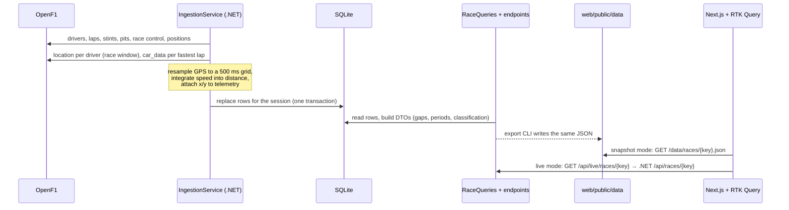

# Application flow

## User flows

1. **Sign in.** Any page redirects anonymous visitors to `/login?next=…`. One click on a demo account (Viewer, Strategist or Admin) sets the session cookie and returns the user to where they were.
2. **Pick a race.** `/` lists cached races as cards (track outline, date, winner).
3. **Replay.** `/race/[key]` shows:
   - the **track map** with every car, moving in real time at 1×–64×;
   - **replay controls**: play/pause, lap jumps, speed, and a scrubber with safety car, VSC and red flag bands;
   - the **timing tower**: position, places gained since the start, gap to the leader, tyre and age, pit stops, IN PIT / OUT states;
   - the **race control** feed and a **track status** badge (green, SC, VSC, red, chequered).
4. **Analyse.** Tabs below the replay:
   - **Tyre strategy:** stints per driver by compound, with a current-lap cursor.
   - **Gap to leader:** one line per driver. Hover isolates a line, click pins it. Teammates are told apart by dashes, not colour alone.
   - **Telemetry** (Strategist+): two drivers' fastest laps overlaid by distance (speed, throttle, brake, gear). Hovering moves markers on a mini track map.
   - **Notes** (Strategist+): pin a note (title, note, category, lap) to the race. Notes appear as markers on the scrubber; clicking one seeks to that lap. Create, edit and delete (with confirmation) happen in an inline form. Stored per user on this device in demo mode.
5. **Follow drivers.** Clicking a driver in the tower, the map or a chart selects them everywhere. `Esc` clears the selection.
6. **Admin** (Admin only): user and role list; re-ingest is disabled in snapshot mode, with the reason shown.

## Data flow



### API endpoints

| Method | Path | Policy | Returns |
| --- | --- | --- | --- |
| GET | `/api/races` | Viewer | race summaries with track outline |
| GET | `/api/races/{key}` | Viewer | race bundle: drivers, laps, stints, pits, positions, events, track periods, gaps per lap, fastest laps, classification |
| GET | `/api/races/{key}/replay` | Viewer | car positions on a fixed 500 ms grid (interleaved x/y arrays) |
| GET | `/api/races/{key}/telemetry` | Strategist | drivers with telemetry |
| GET | `/api/races/{key}/telemetry/{driver}` | Strategist | fastest-lap telemetry by distance |
| POST | `/api/races/{key}/ingest` | Admin | fetch a race from OpenF1 into the cache |
| GET | `/health` | public | health check (includes the database) |
| GET | `/docs` | public | Scalar API reference (OpenAPI) |

Snapshot paths mirror these: `/data/races.json`, `/data/races/{key}.json`, `/data/races/{key}/replay.json`, `/data/races/{key}/telemetry/{driver}.json`.

## State management (Redux Toolkit)

| Kind | Where | What |
| --- | --- | --- |
| Server state | `store/f1Api.ts` (RTK Query) | races, race bundle, replay frames, telemetry. Cached for the session; one `baseQuery` switches between snapshot and live. |
| Client state | `store/replaySlice.ts` | open race, time, playing, speed, selected drivers, `seekId` |
| Client state | `store/telemetrySlice.ts` | the two drivers being compared (reset when a new race opens) |
| Client state | `store/notesSlice.ts` | the user's race notes (entity adapter), persisted to localStorage by listener middleware |
| Session | `store/authSlice.ts` | the signed-in user, preloaded from the verified cookie on the server; read-only on the client |
| Derived | `store/selectors.ts` (`createSelector`) | race model, GPS progress, leaderboard at time t, current lap, track status, recent events |
| Animation | `lib/replayClock.ts` | 60 fps race time for the track map. Not in Redux. |

**Why the animation clock lives outside Redux.** Dispatching on every animation frame would re-run every selector and re-render every subscriber 60 times a second. Instead, `useReplayEngine` runs `requestAnimationFrame`, moves the car markers directly through a `ReplayClock` subscription, and dispatches `timeSynced` about 5 times a second, plus once on pause. User seeks bump `seekId`, which tells the clock to jump. Routine syncs don't, so there's no feedback loop. The timing tower and charts read the coarse Redux time, which is plenty for numbers that change at timing-line cadence.

### How a leaderboard gap is computed

Gaps come from GPS, not just line crossings, so they stay right through pit stops:

1. Each car's position on each 500 ms frame is projected onto the track outline, giving a fraction of the lap. Lap counts come from timing data, and the two are reconciled near the line.
2. The *race front* is the furthest progress any car has reached by each frame. It never decreases.
3. Gap = now minus the moment the front was where this car is now (binary search plus interpolation).
4. Finished or retired cars keep their last line-crossing gap. Without GPS data, the time-based interpolation is used instead.

## Auth flow

```mermaid
sequenceDiagram
  actor U as User
  participant B as Browser
  participant N as Next.js (proxy.ts + route handlers)
  participant A as .NET API

  U->>B: click "Sign in as Strategist"
  B->>N: POST /api/auth/login {email, password}
  N->>N: bcrypt.compare against seeded hash
  N-->>B: Set-Cookie pw_session=<HS256 JWT> (httpOnly, Secure, SameSite=Lax, 8h)
  B->>N: GET /race/9839
  N->>N: proxy.ts verifies JWT, checks role for the path
  N-->>B: page (header shows name and role)
  B->>N: GET /data/races/9839/telemetry/1.json (snapshot)
  N->>N: proxy.ts: telemetry needs Strategist, else 403
  B->>N: GET /api/live/races/9839/telemetry/1 (live)
  N->>A: same path with Authorization: Bearer <cookie JWT>
  A->>A: JwtBearer validates signature, issuer, audience, expiry; Strategist policy
  A-->>N: 200 / 401 / 403
  N-->>B: response
```

Three layers enforce the same permission table (`lib/auth/permissions.ts` on the web side, `Auth/AuthSetup.cs` policies on the API):

- **UI:** the lock icon on Telemetry, "Requires Strategist role" message and hidden Admin link. This is only for discoverability.
- **Next.js `proxy.ts`:** gates pages and the static snapshot files, so a Viewer gets a 403 even for `/data/.../telemetry/*.json`.
- **.NET API:** JWT validation plus role policies. This is the real boundary whenever the API is used.
